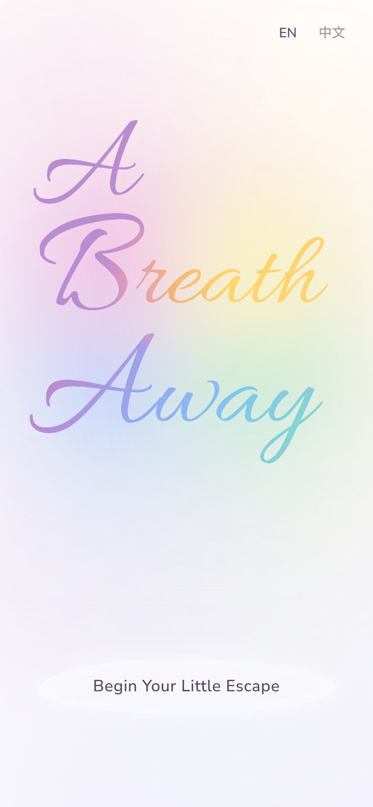
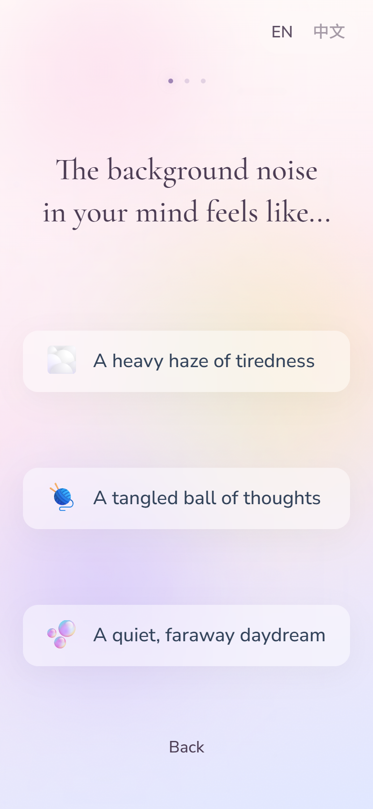
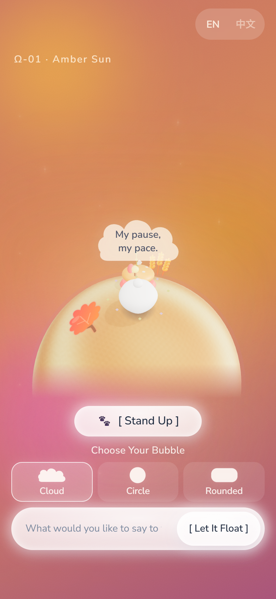
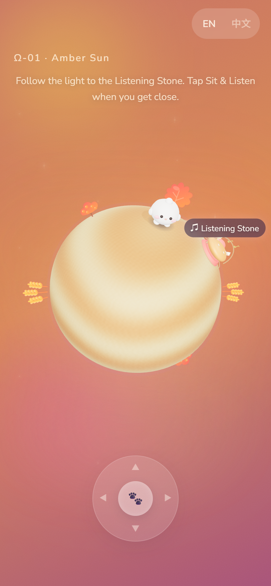
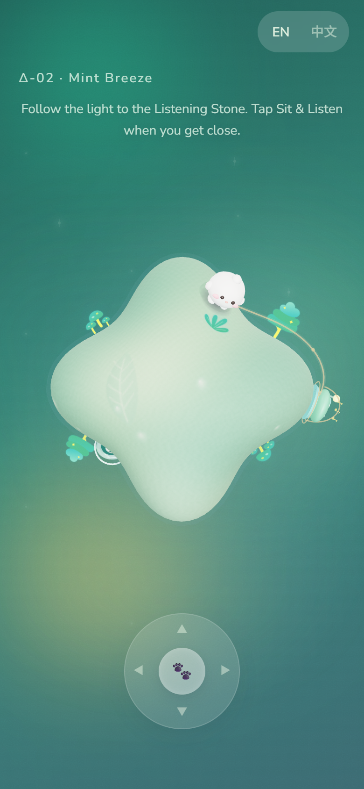
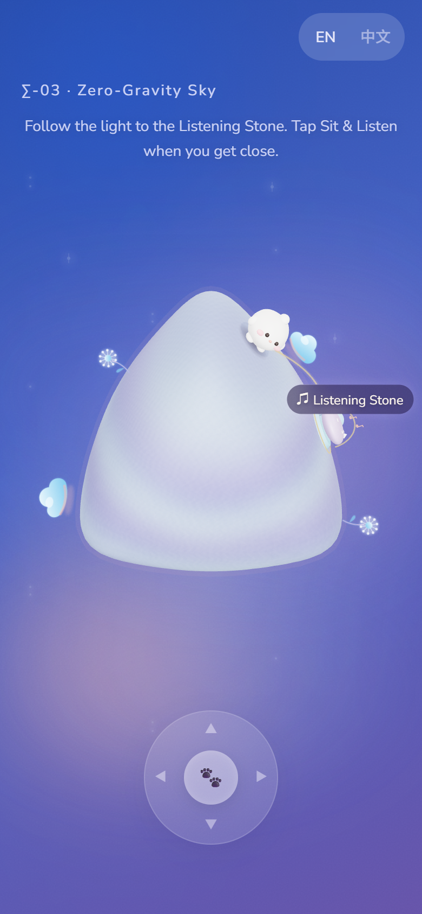
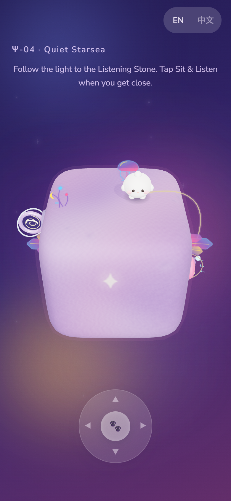
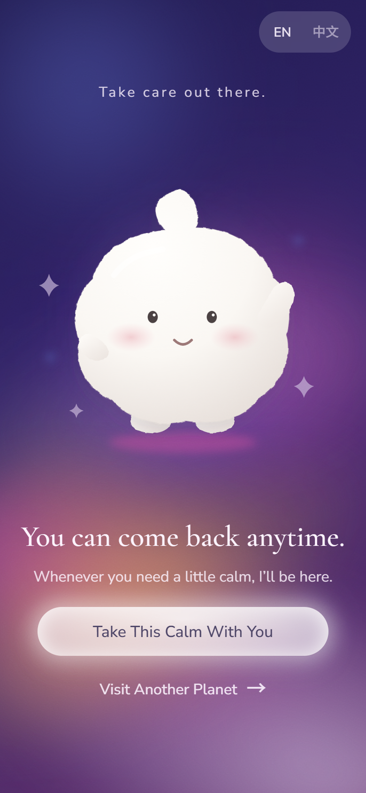

# A Breath Away

**[Try the live experience](https://miajiao5.github.io/Assignment-3-A-Breath-Away/)**

## Idea and intended user

A Breath Away is a lightweight, music-led interactive experience for office workers who want a brief pause from the pressure of the working day. It is designed around a work break of up to ten minutes, between tasks or meetings, when someone wants to step away and unwind but has limited time to leave their workplace.

Visitors answer three gentle questions, explore a small pastel world with a fluffy companion, and sit beside a Listening Stone to hear music. The four worlds have distinct forms: a warm rolling sphere, a mint four-lobed world, a rounded triangular cloud and a soft violet cube. They can also leave a short thought and watch it appear above the companion. Simple choices, gentle sound and immediate visual feedback aim to offer a change of pace before returning to work. There are no scores or timed challenges, and visitors do not need to complete all four planets.

## Screenshots

The main journey: begin, answer three gentle questions, then sit and let a thought float away.

| Cover | Mood check-in and answer choices | Sitting, listening and releasing a thought |
| --- | --- | --- |
|  |  |  |

Each planet has its own shape, surface details, plants and music, with the same exploration controls.

| Ω-01 · Amber Sun | Δ-02 · Mint Breeze |
| --- | --- |
|  |  |
| **Σ-03 · Zero-Gravity Sky** | **Ψ-04 · Quiet Starsea** |
|  |  |

| After selecting Leave |
| --- |
|  |

The farewell background reflects the last planet visited; this example follows Quiet Starsea. All screenshots show the English interface at the same mobile viewport size.

<!-- Optional recording: after adding docs/demo.mp4, add this link here:
[Watch the short demo with sound](docs/demo.mp4)
Alternatively, use the public URL of a GitHub Release asset or hosted recording.
No recording has been added yet; do not publish a link to a missing file.
-->

## Main interaction

1. Select **Begin Your Little Escape**, listen to the introduction, then confirm **I'm Ready**. Each questionnaire choice gives a quiet chime and advances to the next question; **Back** revisits a step.
2. Drag the bottom joystick, or use **WASD / arrow keys**, to explore. The planet rolls as the companion walks, footsteps follow the movement, and nearby plants react. Follow the light to the Listening Stone.
3. Approach the stone and select **Sit & Listen**. Movement stops, the view moves closer and the planet's music fades in. The thought input appears after five seconds.
4. Choose a **Cloud**, **Circle** or **Rounded** bubble, type a thought and select **Let It Float**. The exact text drifts upward along a gentle S-shaped path, gradually shrinking and fading into the sky. Empty or whitespace-only input produces a gentle prompt instead.
5. Select **Stand Up** to resume exploring. After resting on that planet, its portal offers travel to another world. **Leave** becomes available after the first rest; the farewell actions restart the experience or continue the journey.

The top-right language switch changes between English and Simplified Chinese. First visits start in English; an explicit preference is remembered when localStorage is available. Language switching preserves progress, typed text and music playback. User-written text is never translated.

## Run locally

Use Node.js 24 LTS, or Node.js 22.18 or newer, with npm:

```sh
git clone https://github.com/MiaJiao5/Assignment-3-A-Breath-Away.git
cd Assignment-3-A-Breath-Away
npm ci
npm run dev
```

Open the Local URL printed by Vite, normally **http://localhost:3000**. If the port is occupied, use the next URL it prints. Keep the terminal running while previewing.

To check and preview the production build:

```sh
npm run lint
npm run build
npm run preview
```

Open the preview URL printed in the terminal, normally **http://localhost:4173**. Serve the app through Vite rather than opening `dist/index.html` directly. Source files are in `src/`; necessary audio and fonts are in `public/`. Dependencies and exact npm resolutions are documented in `package.json` and `package-lock.json`.

This is a browser project built with React, Three.js, Vite and Web Audio. It needs no API key, Python environment, microphone, paid service or model download at runtime. Generated music and narration are included as audio files; Python was used only to create narration before deployment.

## Known limitations

- A modern browser with WebGL and Web Audio is needed. Older phones may render slowly; the three-person phone trial does not establish compatibility with every device or browser.
- Audio requires an initial user gesture. Unavailable recordings fall back to speech/subtitles or a translated audio message while exploration remains available.
- Preferences and up to 30 released thoughts are stored only in the current browser, without cross-device synchronization. Blocked storage does not prevent the current visit.
- All three trial-inspired responses are implemented: balloon-like message release, distinct planet forms and a higher responsive farewell layout. Browser checks cover the requested phone sizes; follow-up participant testing is still pending. See PROCESS.md.
- A long-circuit automated movement check has reported a small clearance deviation near the Listening Stone. This remains an open check failure.

Read [PROCESS.md](PROCESS.md) for the design process, user trial, improvements and AI use. See [CREDITS.md](CREDITS.md) for software, fonts, course material and generated audio sources.
